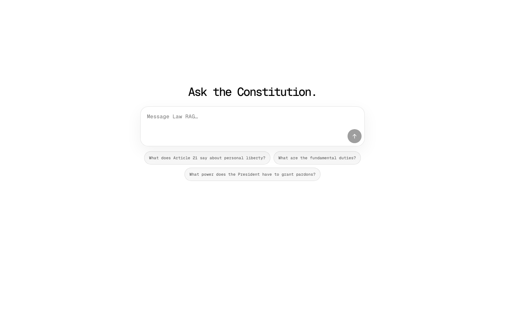

# Indian Law RAG

A learning-focused Retrieval-Augmented Generation app for asking grounded questions about the Constitution of India.



## What it does

- Parses the Constitution PDF into structured Articles.
- Stores Articles, chunks, and embeddings in Neon Postgres with `pgvector`.
- Retrieves relevant constitutional chunks using vector search.
- Generates answers with citations through an Azure OpenAI chat deployment.
- Ships a minimal Next.js chat UI deployed from `apps/web`.

## Architecture

```txt
PDF
→ parser
→ Articles
→ chunks
→ Gemini embeddings
→ Neon pgvector
→ /api/ask
→ Azure OpenAI answer
```

## Apps and packages

```txt
apps/web       Next.js app + /api/ask route
apps/backend   local ingestion, parsing, embedding, and retrieval scripts
packages/db    Prisma schema/client for Neon Postgres
packages/rag   shared runtime RAG logic used by the web API
packages/ui    shared UI package from the Turborepo starter
```

## Environment variables

Set these locally and in Vercel:

```env
DATABASE_URL="postgresql://..."

GEMINI_API_KEY="..."
GEMINI_EMBEDDING_MODEL="gemini-embedding-001"
GEMINI_EMBEDDING_DIMENSIONS="1536"

AZURE_OPENAI_API_KEY="..."
AZURE_OPENAI_BASE_URL="https://YOUR-RESOURCE.openai.azure.com/openai/v1"
AZURE_OPENAI_CHAT_MODEL="..."
AZURE_OPENAI_MAX_COMPLETION_TOKENS="512"
```

For Neon, prefer `sslmode=verify-full` in `DATABASE_URL`.

## Local development

Install dependencies:

```bash
bun install
```

Run the web app:

```bash
cd apps/web
bun --env-file=../backend/.env run dev
```

Open:

```txt
http://localhost:3000
```

## Ingestion scripts

These scripts are local/admin jobs. They are not deployed to Vercel.

```bash
cd apps/backend

# Parse PDF and save Articles + Chunks to Neon
bun run ingestion/ingest-constitution.ts

# Embed chunks and store pgvector rows
bun run ingestion/embed-chunks.ts

# Test retrieval + answer generation from CLI
bun run rag/answer-question.ts "What does Article 21 say?"
```

## Web API

The deployable app exposes:

```txt
POST /api/ask
```

Request:

```json
{
  "question": "What does Article 21 say about personal liberty?"
}
```

Response:

```json
{
  "question": "...",
  "answer": "...",
  "sources": []
}
```

## Deployment

Deploy `apps/web` on Vercel.

Suggested Vercel settings:

```txt
Framework: Next.js
Root Directory: apps/web
Install Command: bun install
Build Command: bun run build
Output Directory: .next
```

The web build runs Prisma generation before `next build`.

## Current dataset

- Document: The Constitution of India
- Parsed Articles: 492
- Chunks: 583
- Embedding dimensions: 1536

## Notes

This project is for learning RAG concepts. It is not legal advice.
